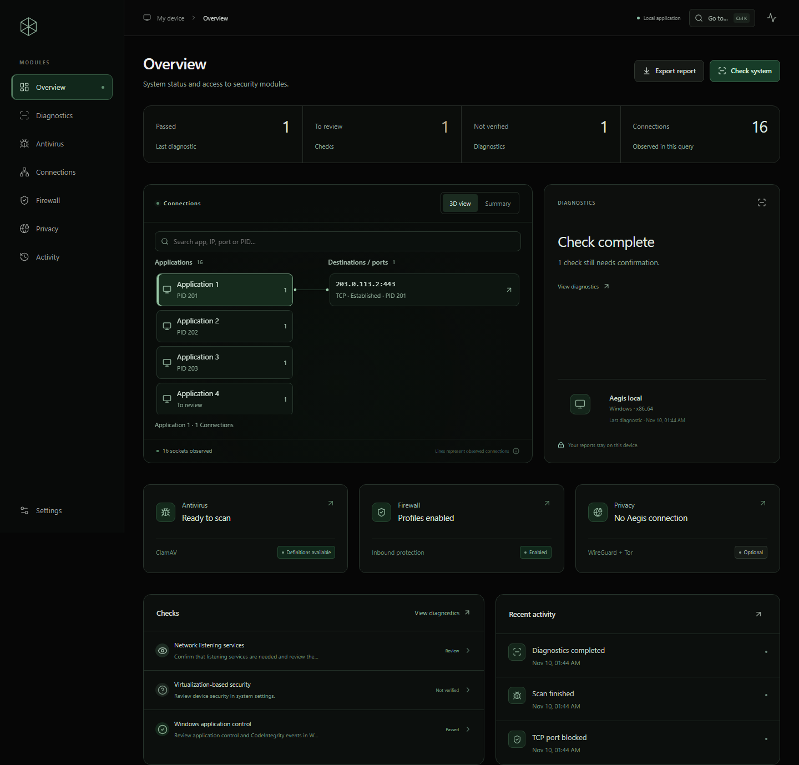

# Aegis

[](https://github.com/henji-ware/Aegis/actions/workflows/desktop.yml)
[](https://github.com/henji-ware/Aegis/releases/latest)
[](LICENSE)

Free and open-source desktop security tools, built with **Tauri 2, Rust, React, TypeScript and Three.js**. Local configuration checks, on-demand ClamAV scanning, native firewall controls, WireGuard profiles and a local Tor proxy.



*Demonstration using synthetic data. No personal IP addresses, device names or scan results are shown.*

## Download

**[Download Aegis 1.0.2](https://github.com/henji-ware/Aegis/releases/tag/v1.0.2)** — stable release. Choose one package for your platform:

| Platform | Packages | Architecture |
|---|---|---|
| Windows | [EXE installer](https://github.com/henji-ware/Aegis/releases/download/v1.0.2/Aegis_1.0.2_x64-setup.exe) · [MSI installer](https://github.com/henji-ware/Aegis/releases/download/v1.0.2/Aegis_1.0.2_x64_en-US.msi) · [Portable ZIP](https://github.com/henji-ware/Aegis/releases/download/v1.0.2/Aegis_1.0.2_windows_x64_portable.zip) | x64 |
| Linux | [DEB](https://github.com/henji-ware/Aegis/releases/download/v1.0.2/Aegis_1.0.2_amd64.deb) · [RPM](https://github.com/henji-ware/Aegis/releases/download/v1.0.2/Aegis-1.0.2-1.x86_64.rpm) · [AppImage](https://github.com/henji-ware/Aegis/releases/download/v1.0.2/Aegis_1.0.2_amd64.AppImage) | x64 |
| macOS | [DMG](https://github.com/henji-ware/Aegis/releases/download/v1.0.2/Aegis_1.0.2_aarch64.dmg) | Apple silicon |

The `.deb` targets Debian-family systems with WebKitGTK 4.1 and compatible native libraries. An installer build on Ubuntu does not imply that every Debian version or desktop environment has been tested. The release pipeline validates installation and removal on Debian 13. Package dependencies and the exact CI results are documented with each release.

### Run on Windows without installing

1. Download and extract the complete portable ZIP.
2. Close any older Aegis instance, including its system-tray instance.
3. Open `aegis-desktop.exe` inside the extracted folder. Keep the `engines` directory and all accompanying files together.

WebView2 remains a system prerequisite; settings and history use your normal user profile. The portable build does not register a Start menu shortcut or uninstaller. Update it by extracting a new complete ZIP. Supported installed builds can check for updates in Settings.

### Release files

Version 1.0.2 reduces the published assets from **26 to 10**: the seven packages linked above, a macOS `.app.tar.gz` updater package, `latest.json`, and one [sources-and-notices archive](https://github.com/henji-ware/Aegis/releases/download/v1.0.2/Aegis_1.0.2_sources-and-notices.tar.gz).

The updater uses `latest.json` and the macOS app archive automatically. The sources-and-notices archive groups corresponding third-party sources, licenses, documentation, `SHA256SUMS.txt`, build metadata and detached signatures. Signatures are also embedded in `latest.json`; separate `.sig` downloads are unnecessary for in-app updates. GitHub adds its own two source-code archives to the release page.

### Changes in 1.0.2

- Clearer typography, spacing and focus states, a responsive overview, and sticky headers in the connection table.
- Search across local and remote ports, IPv6 endpoints, application names and PIDs, with surrounding whitespace ignored.
- Named-application counts that do not count browser worker PIDs as separate applications.
- Conservative evidence handling: unknown TCP states remain unverified, missing executable paths cannot produce a no-local-signals result, and review signals take precedence in the analysis report.
- Fewer release downloads, with signed update compatibility and source/license availability preserved.

## Features

| Module | Behavior |
|---|---|
| Diagnostics | Read-only checks with passed, attention, review and unknown states. Windows checks include Smart App Control, VBS and memory integrity. |
| Antivirus | Independent ClamAV/FreshClam, quick/full/custom scans, inventory-based percentage progress, per-file errors, cancellation, opt-in schedules and explicit reversible quarantine. No Windows Defender dependency. |
| Connections | TCP sockets, process names, local executable inspection and review signals. A selected executable can be scanned with ClamAV. Opt-in monitoring saves bounded change history and shows in-app alerts for new non-loopback listeners. |
| Firewall | Confirmed native hardening, saved prior settings, restoration and owned inbound TCP block rules on Windows/UFW. |
| WireGuard | Strict profile validation, private keys in the OS credential vault, explicit activation and recoverable tunnel state. Local route/DNS evidence and explicit public-IP lookup. Optional scoped Linux nftables blocking outside an active owned single-peer tunnel. No VPN server is supplied. |
| Tor | Bundled Tor client with a loopback-only SOCKS proxy. Applications must opt in to the proxy; it does not route all device traffic. |
| Activity | Local history, comparisons and escaped HTML reports. |
| Automation | Daily or weekly scans, missed-task recovery, four-hour definition updates, optional startup and tray mode. Tasks run while Aegis is running. |
| Updates | Version-bound signed packages, download progress and explicit installation on supported installer/AppImage builds. DEB/RPM and portable ZIP builds update manually. |

Connection analysis uses local evidence. A listening port or a temporary executable location is a reason to review, not proof of malware. No external IP reputation service receives your connections. The dated analysis snapshot remains separate from live monitoring and reports coverage and review reasons. Files of 2 GiB or larger exceed ClamAV’s engine limit and are explicitly reported as not scanned; other configured limits can also restrict smaller files. Files are quarantined only after explicit selection, a fresh detection check and native confirmation. No automatic process termination, deletion or real-time antivirus protection is implemented. ClamAV definitions must be downloaded before normal scans; a completed scan is not a guarantee that a file is safe.

## Interface and languages

Black surfaces with restrained dark green details and a logo-only sidebar. The overview separates diagnostic indicators, connections, device state and module access. The connection explorer has searchable application cards, socket counts and readable destination/listening-port buttons. All applications returned by the native query remain available in scrollable lists; selecting one focuses its destinations, and selecting a destination opens its address, port, protocol, state, PID and analysis details. Arrow keys, Home and End navigate applications. Subtle 3D links represent the selected application's observed sockets, not measured traffic or geography. Parallax respects reduced motion and pauses while hidden; the controls also work without WebGL.

Portuguese, English, Spanish, French, German, Russian, Simplified Chinese, Japanese, Arabic and Hindi are bundled. Language changes are available only in Preferences, take effect immediately and are saved. Arabic uses right-to-left layout. App summaries, recommendations and history headings follow the selected language. Original OS/engine output and legacy records remain available under **Original details**. No translation service is contacted.

## Architecture

`src/` contains React/TypeScript and Three.js. `src-tauri/src/` contains the native Rust implementation. The distributed app has **no Electron or Node.js runtime**. Node.js is used only by frontend/build tooling.

The system WebView renders the interface. Rust accepts a fixed set of validated commands from the local main window. No arbitrary shell, filesystem, remote URL or remote WebView capability is granted to the frontend. Administrative firewall/VPN actions require native confirmation and OS authorization. External engines run as child processes with fixed argument arrays.

Windows WebView2, macOS WKWebView and Linux WebKitGTK are platform dependencies. Their licensing and distribution terms remain applicable. Aegis has no ads, payments, premium tiers, telemetry or mandatory account. Aegis source is MIT licensed; component licenses are preserved separately.

## Build

Install Node.js 22+, the Rust stable toolchain and the [Tauri platform prerequisites](https://v2.tauri.app/start/prerequisites/). Windows builds need Visual Studio C++ Build Tools and WebView2; Linux builds need WebKitGTK 4.1 development packages and D-Bus libraries.

```sh
npm ci
npm run check
npm run prepare:runtimes
node scripts/stage-runtimes.cjs
npm run test:rust
npm run package
```

`npm run dev` runs Tauri development mode. `npm run dev:web` previews only the frontend; native features require the desktop application. Installers are written under `src-tauri/target/release/bundle/`. Runtime downloads are pinned and checked against `runtimes.json`. Packaging excludes the restricted UnRAR modules.

## Validation and migration

The [1.0.2 release workflow](https://github.com/henji-ware/Aegis/actions/runs/42758194727) passed frontend checks, dependency audits, native desktop checks and publication. The frontend suite includes nine tests and UI coverage across ten languages; native checks exercise engines, package installation and signed updater artifacts. Browser UI tests use a mocked native transport. Native Windows UI checks run separately in CI; package and engine checks on macOS do not imply a full interactive macOS GUI test.

See [validation](docs/VALIDATION.md), [security](docs/SECURITY.md), [dependency review](docs/DEPENDENCY-REVIEW.md), [Windows compatibility](docs/WINDOWS-COMPATIBILITY.md) and [release notes](docs/RELEASE-NOTES.md). The screenshot shows the 1.0.2 interface with illustrative test data.

Electron data is preserved when migrating. Compatible settings, history and firewall recovery information are copied to the Tauri store. VPN profiles need to be reimported into the new OS credential vault. An existing owned tunnel is retained for explicit recovery/disconnection when its configuration can be copied. Disconnect VPNs using the previous version before switching whenever possible. Invalid local data is preserved and recovered from its last valid backup instead of silently discarded.

## Signatures and licenses

Update packages have version-bound signatures. Windows packages currently have no trusted Authenticode signature, and macOS packages have no Developer ID signature or notarization. Operating-system application-control policies may prevent execution; updater signatures and GitHub provenance do not replace platform publisher certificates.

See [third-party notices](docs/THIRD-PARTY-NOTICES.txt) and [LICENSE](LICENSE). Aegis source is MIT licensed; bundled components retain their own licenses. Corresponding engine sources accompany releases in the sources-and-notices archive.

Verify build provenance with `gh attestation verify <installer> --repo henji-ware/Aegis`. Extract `SHA256SUMS.txt` from the sources-and-notices archive to check the downloaded package's SHA-256 value. Build metadata and detached signatures are available in that same archive.
