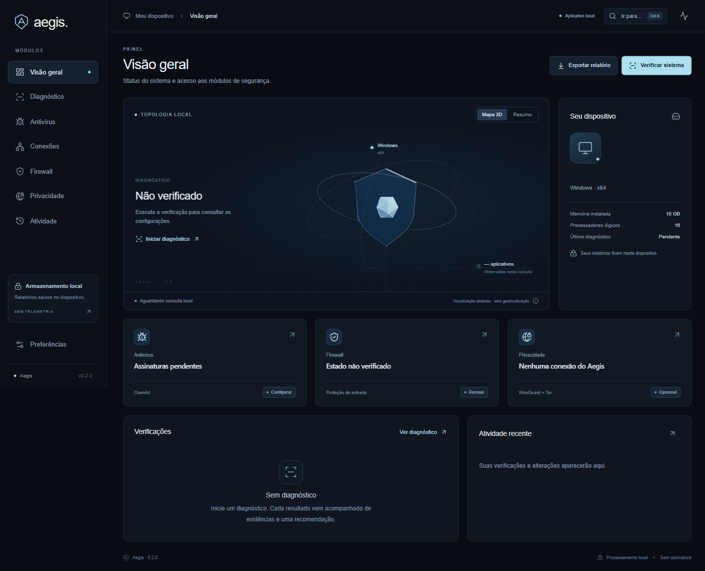

# Aegis 0.2.1

Central de segurança e privacidade para desktop, gratuita e com código-fonte aberto.
Interface em português, visualização 3D, diagnóstico local, antivírus independente,
firewall, WireGuard, Tor e histórico em um fluxo único.

## Usar no Windows

1. Extraia **toda** a pasta da distribuição.
2. Abra **Aegis.exe**. Não é preciso instalar Node.js para usar o pacote pronto.
3. Em **Antivírus**, clique em **Preparar assinaturas**. O FreshClam baixa e valida
   a base oficial. O primeiro download exige internet e pode ser grande.
4. Escolha uma varredura rápida, completa ou personalizada.
5. Em **Diagnóstico**, execute **Verificar sistema** e abra cada resultado para
   consultar evidências e recomendações.

Não há dependência do Windows Defender. ClamAV e Tor estão incluídos no pacote
Windows. O cliente WireGuard também está incluído; um perfil e um servidor são
necessários para conectar uma VPN. O Aegis não comercializa serviços.

## O que funciona nesta versão

- Diagnóstico de configurações, com distinção entre atendido, atenção, revisar e
  não verificado. Não existe um escore artificial de segurança.
- ClamAV sob demanda, atualizado pelo FreshClam, cancelamento e resultados reais.
  Nenhum arquivo é enviado a serviços de análise ou apagado automaticamente.
- Conexões TCP e processos, com busca, filtros e atualização manual ou a cada 12s.
- Firewall nativo: reforço com cópia dos valores anteriores, restauração e regras
  próprias de bloqueio de entrada TCP onde há suporte.
- Perfis WireGuard validados: scripts PreUp/PostUp/PreDown/PostDown e outras
  diretivas executáveis são rejeitados. Chaves são guardadas usando safeStorage.
- Tor integrado com proxy SOCKS5 exclusivo em loopback e progresso informado pelo
  mecanismo. Ele não altera o proxy global nem encaminha todos os aplicativos.
- Relatório HTML, histórico local, comparação de diagnósticos, navegação rápida
  (Ctrl+K) e preferência por movimento reduzido.

## Cobertura e limites

A versão pronta foi compilada para **Windows x64**. A interface e os adaptadores
incluem macOS e Linux, mas os pacotes desses sistemas precisam ser gerados e
validados nos respectivos ambientes. Não os considere homologados a partir do
teste no Windows.

| Recurso | Windows | macOS | Linux |
|---|---|---|---|
| Interface, relatórios e histórico | Implementado | Implementado | Implementado |
| Diagnóstico | PowerShell / APIs nativas | FileVault / firewall | Conexões / UFW |
| ClamAV | Incluído no pacote | Preparador do pacote oficial | Preparador .deb oficial |
| Reforço de firewall | Perfis e política de entrada | Firewall de apps e modo discreto | UFW |
| Bloqueio de porta TCP | Implementado | Não oferecido | UFW |
| VPN | Serviço WireGuard incluído | wg-quick externo | wg-quick externo |
| Tor | Incluído | Preparador do bundle oficial | Preparador do bundle oficial |

No macOS, use wireguard-tools. O adaptador resolve o mapeamento do túnel para a
interface utun pelo arquivo gerado pelo wg-quick. A lógica foi testada com
adaptadores controlados; a execução nativa ainda exige validação no macOS. No Linux, UFW, iproute2, PolicyKit
e wireguard-tools devem estar disponíveis para os recursos correspondentes.
Um chaveiro seguro (Secret Service/KWallet) é necessário para importar VPN:
o fallback basic_text é recusado.

O antivírus não oferece proteção em tempo real, garantia de detectar todas as
ameaças, análise irrestrita de arquivos ou suporte interno a RAR. A leitura
depende das permissões da sessão. A varredura completa pode ser parcial em pastas
protegidas. Limites: 100 MB por arquivo e 400 MB de conteúdo extraído; links
simbólicos e outros sistemas de arquivos não são percorridos.

Uma interface VPN ativa não comprova handshake, roteamento integral, DNS seguro
ou ausência de vazamentos. Não há kill switch nesta versão. O Tor só protege o
tráfego dos aplicativos configurados para usar o proxy. Para navegação, use o
Tor Browser oficial.

Firewall: alterações pedem revisão e autorização do SO. Uma configuração de
empresa pode impedir ações. Não há manipulação de drivers próprios nem reset
global de regras. Se uma ação for interrompida, a configuração anterior e as
regras pendentes permanecem registradas para revisão/remoção.

## Controle de aplicativos do Windows

O diagnóstico consulta Smart App Control, política de integridade de código,
VBS e integridade da memória sem alterar a configuração. Consultas negadas
ficam como não verificadas; configuração e execução são estados distintos.

Esta distribuição não tem assinatura digital. Neste computador, o Smart App
Control bloqueou o Aegis.exe. A causa foi confirmada por eventos CodeIntegrity,
conforme docs/COMPATIBILIDADE-WINDOWS.md. A versão 0.2.1 melhora o diagnóstico;
ela não remove o bloqueio de confiança do executável.

## Desenvolvimento

Requisitos: Node.js 22.12 ou mais recente, npm e ferramentas nativas do sistema.

~~~sh
npm ci
node node_modules/electron/install.js
npm run prepare:runtimes
npm run dev
~~~

Os mecanismos são baixados dos projetos oficiais com SHA-256 fixado. No Windows,
o preparador extrai o MSI WireGuard como contêiner de arquivos; não o instala.
O preparo macOS requer pkgutil; Linux requer dpkg-deb. No macOS, o preparador reloca dependências das dylibs e aplica assinatura
ad-hoc aos binários locais; a homologação nativa ainda é necessária.

~~~sh
npm test
npm run build
npm run package
~~~

O empacotamento inclui apenas recursos necessários e exclui o plugin UnRAR.
Os artefatos são gerados em release/. Para usar um ZIP Electron já baixado,
defina AEGIS_ELECTRON_ZIP_DIR para a pasta que o contém.

Os scripts de teste real usam apenas arquivos de teste. AEGIS_DATA_DIR pode
direcionar o armazenamento de desenvolvimento para uma pasta isolada.
Nunca inclua perfis VPN, chaves, state.json ou relatórios reais em um repositório.

## Arquitetura

~~~text
React / Three.js (renderer isolado, sem acesso ao Node)
        ↓ IPC com operações e origem validadas
Electron main / adaptadores por plataforma
        ├─ ClamAV / FreshClam
        ├─ Firewall nativo
        ├─ WireGuard
        ├─ Tor (proxy local)
        └─ Armazenamento local e cofre do SO
~~~

As operações nativas usam argumentos separados, sem shell genérico. Comandos
PowerShell fixos são codificados e os valores variáveis são validados/escapados.
Somente operações administrativas específicas pedem elevação. A interface não
roda como administrador. Nenhum site remoto é carregado dentro do aplicativo.

Ao fechar o Aegis, o proxy Tor é encerrado. Um serviço/túnel WireGuard ativo
permanece no sistema até ser desconectado; reabra o Aegis para gerenciá-lo.

Os dados ficam no diretório userData do Electron para Aegis. Histórico e
relatórios são locais; perfis VPN persistidos usam o cofre do sistema.
Durante conexão no Windows, o arquivo de serviço usa DPAPI LocalMachine no
diretório privado do usuário, permitindo leitura pelo serviço LocalSystem.
No Unix, wg-quick requer um arquivo de configuração privado (0600) enquanto o
túnel estiver ativo. Ele é removido ao desconectar. Não exporte esse diretório.

## Portfólio

Veja docs/PORTFOLIO.md para apresentar o projeto e docs/VALIDACAO.md para os testes.
Licença do código original: MIT. Os componentes mantêm suas próprias licenças.
Veja LICENSE e docs/THIRD-PARTY-NOTICES.txt.

## Alterações em 0.2.0

- Textos funcionais, sem slogans; nova cena 3D com escudo e órbitas.
- Parallax de cursor e rolagem, cartões com inclinação discreta e movimento reduzido.
- Correção do formato DPAPI WireGuard, incluindo descrição vinculada ao túnel.
- Recuperação de falhas VPN, status desconhecido explícito e bloqueio de concorrência.
- UFW não adota regras externas; portas duplicadas são rejeitadas.
- Antivírus preserva detecções anteriores em saídas longas e marca análise parcial.
- Backup de estado, recuperação de arquivo corrompido e uma instância por perfil.
- Parsers de rede Linux/macOS e identificação de interfaces utun.
- Workflow de CI para Windows, Linux e macOS em .github/workflows/desktop.yml.
  O workflow foi preparado como código; não foi executado em serviço externo nesta sessão.

## Alterações em 0.2.1

- Consultas somente de leitura para Smart App Control, VBS e integridade da memória.
- Estados indisponíveis, desativados, em avaliação e em execução tratados separadamente.
- Documentação da causa confirmada do bloqueio do executável no Windows.
- 37 testes automatizados aprovados e compilação TypeScript/Vite concluída.

## Execução do pacote Windows nesta sessão

O Smart App Control bloqueou Aegis.exe pela política
`VerifiedAndReputableDesktop`. Os eventos 3077 e 3089 correlacionados mostraram
zero assinaturas digitais. Isso esclarece o aviso genérico de Device Guard;
não comprova que exista uma política de organização neste computador.
Nenhuma política foi alterada nem certificado instalado para contornar o bloqueio.

Os testes de integração executam o código com o runtime oficial de desenvolvimento
do Electron. Os pacotes Windows permanecem sem validação de execução final neste
ambiente; macOS e Linux ainda precisam de homologação nativa.
